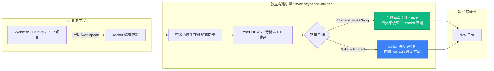

<div align="center">

# 🐳 TypePHP AOT Compiler Docker Engine

**通用 PHP AOT 静态编译与可移植二进制打包 Docker 镜像底座**

[](https://hub.docker.com/r/tinywan/typephp-builder)
[](LICENSE)
[](https://github.com/swoole/typephp)
[-success.svg?logo=linux&style=flat-square)](https://github.com/Tinywan/docker-typephp-builder)

</div>

---

## 📌 架构定位

本项目是 **TypePHP AOT 静态编译底座引擎**。将 **Alpine Linux、Musl-libc、Clang、PHP Embed、Swoole PHPX 静态 SDK 及 TypePHP 编译器** 完全封装于容器中。

通过将宿主机或 CI 流水线与复杂编译依赖（C++17 / Clang / Sysroot）彻底解耦，开发者只需挂载源码目录，即可将 **Webman**、**Laravel**、**ThinkPHP** 或任意 TypePHP 项目一键编译为面向 Linux x86_64 的原生高性能二进制程序。



---

## ✨ 核心特性

- 📦 **两种编译交付形态**：
  - **Alpine Musl 全静态单文件（🌟 推荐）**：纯静态链接，体积约 6MB，零共享库依赖，可在 CentOS / Ubuntu / Alpine / Scratch 最小化容器中直跑。
  - **Linux Glibc 动态便携包**：自动利用 `ldd` 探查并打包底层动态库与扩展，自包含 `php.ini` 与 RPATH 封装。
- ⚡ **容器原生存储编译加速**：自动将宿主机挂载目录同步至容器内部 Native Storage 编译，彻底规避 Windows / macOS 上 Docker Desktop 挂载（9P / VirtioFS）的高 I/O 延迟。
- 🧩 **多框架通用**：支持识别标准 `project.yml` 与 Webman 专用的 `project.linux.yml`，兼顾通用 PHP 项目与 Webman / SaiAdmin 框架。
- 🩺 **内置环境自检（Doctor）**：支持直接运行 `doctor` 指令查看当前镜像的编译器、Clang 及系统架构信息。

---

## 🖥️ 支持的操作系统与 PHP 版本矩阵

本构建器严格遵循 [Swoole TypePHP 官方系统与版本规范](https://github.com/swoole/typephp)：

### 1. 宿主操作系统与架构支持

| 宿主操作系统 | 芯片架构 | 运行方式 | 性能与架构特点 |
| :--- | :--- | :--- | :--- |
| **macOS** | **Apple Silicon (`arm64`)**<br>*(M1 / M2 / M3 / M4)* | Docker Desktop | **原生架构高速执行**，自动拉取原生 `linux/arm64` 镜像，彻底告别 QEMU 模拟 |
| **macOS** | Intel (`x86_64`) | Docker Desktop | 原生 `linux/amd64` 镜像 |
| **Linux** | `x86_64` / `amd64`<br>*(Ubuntu, Debian, CentOS, Alpine 等)* | Docker 原生运行 | 原生 `linux/amd64` 镜像 |
| **Linux** | `aarch64` / `arm64`<br>*(ARM 云服务器, 树莓派等)* | Docker 原生运行 | 原生 `linux/arm64` 镜像 |
| **Windows** | Windows 10 / 11 (`x86_64`) | Docker Desktop (WSL2) | 原生挂载运行，支持直接双击 `build.cmd` 一键执行 |

### 2. PHP 版本与运行时对应关系

- **TypePHP 编译器内核版本**：默认内置并升级至最新的 **`swoole/typephp:^0.9.5`**（编译器自身要求 `PHP >=8.4 <8.6`）。
- **Alpine 纯静态镜像**：内置 **PHP 8.5.0** 静态嵌入核心（`libphp.a`）与 Swoole PHPX，产出体积约 ~6MB 纯静态单文件。
- **Ubuntu Glibc 镜像**：内置 **PHP 8.4** 嵌入式运行时（`libphp.so`）与全部常用扩展，产出开箱即用的便携动态目录。
- **业务项目源码兼容**：完整支持编写自 PHP 8.1 / 8.2 / 8.3 / 8.4 的 Webman / Laravel / ThinkPHP 项目。

---

## 🏷️ Docker 镜像标签一览

| 编译形态 | 浮动最新标签 (Floating Tag) | 固定版本标签 (Pinned Version Tag) | 说明 |
| :--- | :--- | :--- | :--- |
| **Alpine Musl 全静态单文件 (推荐)** | `tinywan/typephp-builder:alpine`<br>`tinywan/typephp-builder:static`<br>`tinywan/typephp-builder:latest` | `tinywan/typephp-builder:0.9.4-alpine`<br>`tinywan/typephp-builder:0.9.4` | 生成 ~6MB 纯静态单文件，无外部依赖 |
| **Ubuntu Glibc 动态便携包** | `tinywan/typephp-builder:glibc` | `tinywan/typephp-builder:0.9.4-glibc` | 动态链接，内置扩展与 `dist/lib` 运行时 |
| **历史插件兼容别名** | `tinywan/typephp-webman-builder:alpine` | `tinywan/typephp-webman-builder-static:0.9.4`<br>`tinywan/typephp-webman-builder:0.9.4` | 兼容旧版插件别名 |

---

## 🚀 快速上手

### 1. 基础编译命令（Linux x86_64 / macOS Apple Silicon / Windows）

进入你的 Webman 或 TypePHP 项目根目录（需已包含 `project.linux.yml` 或 `project.yml`）：

```bash
# 镜像原生支持 x86_64 与 arm64，macOS (M1/M2/M3/M4) 将自动跑原生高速 ARM64 编译：
docker run --rm \
  -v "$(pwd)":/workspace \
  tinywan/typephp-builder:alpine
```

编译成功后，产物将生成在当前项目的 `dist/` 目录下：
```bash
cd dist
./start.sh start
# 或直接运行单一二进制文件
./webman-server start
```

---

### 2. 自定义参数运行

可以通过环境变量控制构建行为：

```bash
docker run --rm \
  --platform linux/amd64 \
  -v "$(pwd)":/workspace \
  -e TYPEPHP_OUTPUT_DIR=build-out \
  -e TYPEPHP_OUTPUT_NAME=my-app \
  -e TYPEPHP_FORCE=1 \
  tinywan/typephp-builder:alpine
```

---

### 3. 环境自检（Doctor 模式）

验证当前使用的编译镜像环境是否正常：

```bash
docker run --rm tinywan/typephp-builder:alpine doctor
```

输出示例：
```ts
================================================================
  TypePHP AOT Builder Environment (Alpine Musl Full-Static)
================================================================
OS: Alpine Linux v3.21
Kernel: 5.15.0-xxx
Architecture: x86_64
Clang version: clang version 19.x.x
TypePHP compiler (tpc):
  Found at /opt/typephp/vendor/bin/tpc.php
================================================================
```

---

## ⚙️ 环境变量说明

| 环境变量 | 默认值 | 可选值 | 说明 |
| :--- | :---: | :---: | :--- |
| `TYPEPHP_STATIC` | `1`（Alpine）/ `0`（Glibc） | `1`, `0` | 是否启用全静态 Musl 单文件编译（`--full-static`） |
| `TYPEPHP_OUTPUT_DIR` | `dist` | 相对路径 | 编译产物输出目录（相对于项目根目录） |
| `TYPEPHP_OUTPUT_NAME` | *(自动推断)* / `app-server` | 字符串 | 编译生成的目标可执行文件名。默认自动从 `project.yml` 的 `output` 提取；若未配置则兜底为 `app-server` |
| `TYPEPHP_FORCE` | `0` | `1`, `0` | 若输出目录已存在，是否强制覆盖 |

---

## 🔗 与 Webman 插件联动

在 Webman 项目中配合官方推荐插件 [`tinywan/webman-typephp`](https://github.com/Tinywan/webman-typephp) 使用时，插件会自动调度本镜像：

```bash
# 1. 在 Webman 项目中安装插件
composer require tinywan/webman-typephp --dev

# 2. 运行一键打包命令（自动生成 project.linux.yml 并调用本镜像）
php webman typephp:package --static
```

---

## 🛠️ 本地开发与构建镜像

若需要自行二次定制或构建此镜像：

```bash
# 1. 克隆本仓库
git clone https://github.com/Tinywan/docker-typephp-builder.git
cd docker-typephp-builder

# 2. 本地构建 Alpine 静态镜像
docker build -t tinywan/typephp-builder:alpine ./alpine

# 3. 本地构建 Glibc 镜像
docker build -t tinywan/typephp-builder:glibc ./glibc

# 4. 或者通过 docker-compose 构建并验证
docker compose build
```

---

## 📄 开源协议

本项目采用 [MIT 协议](LICENSE) 开源。
